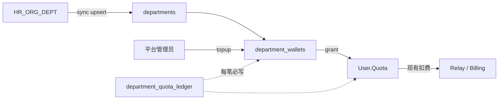

# 部门钱包 P0 实现计划

> **给代理工作者：** 执行本计划时使用现有测试约定（`testify/require` + `assert`），按任务顺序推进；每完成一个任务再提交（仅当用户要求提交时）。步骤用复选框跟踪。

**目标：** 从 HR 部门数据同步组织树，建立部门余额池，平台管理员可向部门充值并把额度划拨到个人 `User.Quota`；API 调用仍走现有个人钱包扣费，不改 relay/billing 主链路。

**架构：** 本地表镜像 HR 部门树 + 独立 `department_wallets` + 强制账本 `department_quota_ledger`。所有余额变动在事务内行锁划转；划到个人时复用 `IncreaseUserQuota` / 与现有用户额度审计对齐。部门管理人、子部门互转、人员自动挂靠留到 P1/P2。

**技术栈：** Go（根模块）、GORM、Gin、现有 `middleware.AdminAuth`、SQLite/MySQL/PostgreSQL 三库兼容。

**范围外（P0 不做）：** 部门管理人角色、部门→子部门划拨 UI、请求时扣部门池、改 `User.Group` 语义、前端完整组织管理台（可先 API + 最小列表）。

---

## 资金流（对照）



## HR 字段映射

| HR_ORG_DEPT | 本地 | 备注 |
|-------------|------|------|
| `DEPT_NO` | `external_no` UNIQUE | 同步主键 |
| `DEPT_ID` | `external_id` | HR GUID |
| `DEPT_NAME` | `name` | |
| `P_DEPT_NO` | `parent_external_no` → 解析 `parent_id` | |
| `COMP_NO` | `company_no` | |
| `LEVEL` / `F_ORDER` | `level` / `sort_order` | |
| `IS_DEL` / `ISSEALUP` | `status` disabled | 不物理删除 |
| `DEPT_TYPE` | `source_type` | |

## 文件结构（预计）

| 文件 | 职责 |
|------|------|
| `model/department.go` | 部门树实体、查询、状态 |
| `model/department_wallet.go` | 钱包余额、行锁划转原语 |
| `model/department_quota_ledger.go` | 账本写入与查询 |
| `model/department_sync.go` | upsert + 建树 + 停用 |
| `service/department_wallet.go` | topup / grant_to_user 用例（事务+账本） |
| `controller/department.go` | 管理端 API |
| `router/api-router.go` | 挂 admin 路由 |
| `model/main.go` | AutoMigrate 注册 |
| `model/department_wallet_test.go` | P0 核心回归（单一测试文件集中） |

---

## Chunk 1: 数据模型与迁移

### 任务 1：部门与钱包模型

**文件：**
- Create: `model/department.go`
- Create: `model/department_wallet.go`
- Create: `model/department_quota_ledger.go`
- Modify: `model/main.go`（`AutoMigrate` 列表加入新模型）
- Test: `model/department_wallet_test.go`

- [x] **步骤 1：写失败测试 — 迁移后可创建部门与零余额钱包**

在 `model/department_wallet_test.go` 用现有测试 DB helper（与其他 `model/*_test.go` 相同初始化方式）断言：

```go
func TestDepartmentWalletMigrateAndCreate(t *testing.T) {
	// AutoMigrate Department + DepartmentWallet
	// Create department external_no="10100"
	// EnsureWallet(deptID) => quota=0, used_quota=0
	// 再 EnsureWallet 幂等，不报错、余额仍为 0
}
```

- [ ] **步骤 2：运行测试，确认失败**

```powershell
go test ./model -run TestDepartmentWalletMigrateAndCreate -count=1
```

Expected: FAIL（类型/表不存在）

- [ ] **步骤 3：实现最小模型**

`Department` 建议字段：`Id`, `ExternalNo`, `ExternalId`, `Name`, `CompanyNo`, `ParentId *int`, `ParentExternalNo`, `Level`, `SortOrder`, `SourceType`, `Status`（enabled/disabled）, `LastSyncedAt`, 时间戳。

`DepartmentWallet`：`DepartmentId` UNIQUE, `Quota`, `UsedQuota`。

`DepartmentQuotaLedger`：`Id`, `DepartmentId`, `Type`（`topup`/`grant_user`）, `Amount`, `DeptQuotaBefore/After`, `TargetUserId`, `OperatorUserId`, `Remark`, `CreatedAt`。金额约定：部门侧减少为负或用绝对额+方向字段（实现时二选一，全项目统一；推荐 `Amount` 为部门钱包变化量，`topup>0`, `grant_user<0`）。

- [ ] **步骤 4：注册 AutoMigrate 并跑通测试**

```powershell
go test ./model -run TestDepartmentWalletMigrateAndCreate -count=1
```

Expected: PASS

- [ ] **步骤 5：补唯一索引测试**

断言同一 `external_no` 第二次 Create 失败（或 OnConflict 语义在 sync 任务再测）。

---

## Chunk 2: 划转服务（核心不变量）

### 任务 2：部门充值与划拨到个人

**文件：**
- Create: `service/department_wallet.go`
- Test: `model/department_wallet_test.go`（继续集中回归，或 `service/department_wallet_test.go` 二选一；**不要**拆多个平行测试文件）

**不变量：**
1. 事务内对 `department_wallets` 使用 `lockForUpdate(tx)`（SQLite 跳过 FOR UPDATE 的现有约定）。
2. 余额不足则整笔回滚。
3. 成功必须写 ledger。
4. `grant_to_user`：部门 `Quota` 减少，用户 `IncreaseUserQuota`；不得只改一侧。
5. 禁用部门禁止 topup/grant。

- [ ] **步骤 1：写失败测试**

```go
func TestDepartmentTopupAndGrantToUser(t *testing.T) {
	// topup 1000 -> wallet.quota==1000, ledger type=topup
	// grant 300 to user -> wallet.quota==700, user.quota +=300
	// grant 800 -> error insufficient, wallet 仍 700
}
```

- [ ] **步骤 2：跑测试确认失败**

```powershell
go test ./model -run TestDepartmentTopupAndGrantToUser -count=1
# 若测放在 service：
# go test ./service -run TestDepartmentTopupAndGrantToUser -count=1
```

- [ ] **步骤 3：实现 `TopupDepartment` / `GrantDepartmentToUser`**

伪代码要点：

```go
err := model.DB.Transaction(func(tx *gorm.DB) error {
	wallet, err := getWalletForUpdate(tx, deptID)
	// check status, amount > 0, sufficient
	// updates + IncreaseUserQuota in same tx if可能；若 IncreaseUserQuota 不接 tx，则抽可注入 tx 的路径或同事务封装
	// insert ledger
	return nil
})
```

若现有 `IncreaseUserQuota` 不支持 `tx`，优先在本任务内增加 **仅包内使用** 的 `increaseUserQuotaTx(tx, id, quota)`，避免改计费主路径行为；现有签名保持不变。

- [ ] **步骤 4：测试通过 + 并发冒烟（可选短测）**

两 goroutine 同时 grant 接近耗尽余额，最终 `wallet.quota >= 0` 且 `wallet.quota + sum(granted) == topup`。

---

## Chunk 3: HR 同步

### 任务 3：按 DEPT_NO upsert 组织树

**文件：**
- Create: `model/department_sync.go` 或 `service/department_sync.go`
- Test: 同一 `department_wallet_test.go` 或 `department_sync_test.go`（最多再加 **一个** 测试文件）

**P0 同步输入（默认）：**
1. 管理端 POST JSON 批次（字段对齐 HR 列名或内部 DTO）。
2. 可选：配置 HR 只读 DSN 后 `SyncFromHRDB`（同一 upsert 逻辑）。

用你提供的样例校验：

```text
10 集团公司
├─ 10100 办公室
├─ 10110 党委组织部（人力资源中心）
└─ 10120 党群工作部
```

- [ ] **步骤 1：写失败测试 `TestSyncDepartmentsFromHRRows`**

输入 4 行样例 → 4 个 department；`10100.parent_id` 指向 `10`；每部门自动 `EnsureWallet`；将某行 `IS_DEL=1` 再同步 → status=disabled，钱包行仍在。

- [ ] **步骤 2：实现 Sync**

算法：
1. Upsert 全部节点（先不依赖 parent_id）。
2. 第二遍按 `parent_external_no` 解析 `parent_id`（根的 `P_DEPT_NO=00` 或空 → parent_id=null）。
3. 本次未出现且来源为 HR 的节点：可选标记 disabled（P0 可只处理显式 IS_DEL/ISSEALUP）。
4. 新部门 EnsureWallet(0)。

- [ ] **步骤 3：跑测试 PASS**

```powershell
go test ./model -run TestSyncDepartmentsFromHRRows -count=1
```

---

## Chunk 4: 管理端 API

### 任务 4：Admin API

**文件：**
- Create: `controller/department.go`
- Modify: `router/api-router.go`（AdminAuth 组下）
- Test: 可在 `controller/department_test.go` **仅一个** HTTP 级测试文件，覆盖 topup/grant 权限与余额；若 Chunk2 已覆盖不变量，此处只测鉴权与参数错误。

**路由建议（均 AdminAuth）：**

| Method | Path | 作用 |
|--------|------|------|
| GET | `/api/department` | 树或列表 |
| POST | `/api/department/sync` | 提交 HR 行批次同步 |
| POST | `/api/department/:id/topup` | `{quota, remark}` |
| POST | `/api/department/:id/grant` | `{user_id, quota, remark}` |
| GET | `/api/department/:id/ledger` | 账本分页 |

- [ ] **步骤 1：写 API 失败测试（未实现路由 → 404）再实现**
- [ ] **步骤 2：成功路径：admin topup → grant → 查用户额度增加**
- [ ] **步骤 3：非 admin 被拒**

消息用 `common.ApiErrorT` / `ApiSuccessT`，英文 key；若前端暂不展示，P0 可先不补齐全部 locale（若管理台要显示，再开 i18n 任务）。

**审计：** 参照 `manageUserQuota`，对 topup/grant 写 `RecordOperationAuditLog`（动作名如 `department.quota_topup` / `department.quota_grant`），审计内容不含密钥。

---

## Chunk 5: 配置与手测清单

### 任务 5：配置项与验收

**文件（按需）：**
- `setting/...` 或 Option 键：`department.hr_dsn`（可选）、`department.sync_enabled`
- 不强制 P0 做定时任务；有 DSN 时可在 `main.go` 用现有 `SyncFrequency` 风格挂 `go syncLoop`（可选任务，默认关）

- [ ] **步骤 1：用样例 JSON 调 `POST /api/department/sync`**
- [ ] **步骤 2：给「集团公司」或「办公室」topup**
- [ ] **步骤 3：grant 到测试用户，确认控制台用户额度增加且能调模型**
- [ ] **步骤 4：确认 ledger 两条流水**
- [ ] **步骤 5：三库至少在开发环境跑通 `go test` 相关包；若无法起 MySQL/PG，在交接中写明 blocker，不声称已完成三库验证**

---

## 验收标准（P0 Done）

1. HR 样例 4 部门可同步成树，停用行不删钱包。
2. 管理员能给部门充值、划拨到个人；余额不足拒绝。
3. 个人额度增加后，现有聊天/API 扣费行为不变。
4. 每笔划转有 ledger + 管理审计。
5. 相关测试集中、可重复；未引入部门扣费到 `FundingSource`。

## 后续（不在本计划）

- **P1：** `department_managers`、管理人仅能划本部门、部门→子部门、回收、管理 UI  
- **P2：** 人员-部门同步、OIDC 登录自动挂靠  

---

## 执行交接

计划已保存到 `.agents/plans/2026-11-02-department-wallet-p0.md`。

准备开始按 Chunk 1 执行实现吗？
