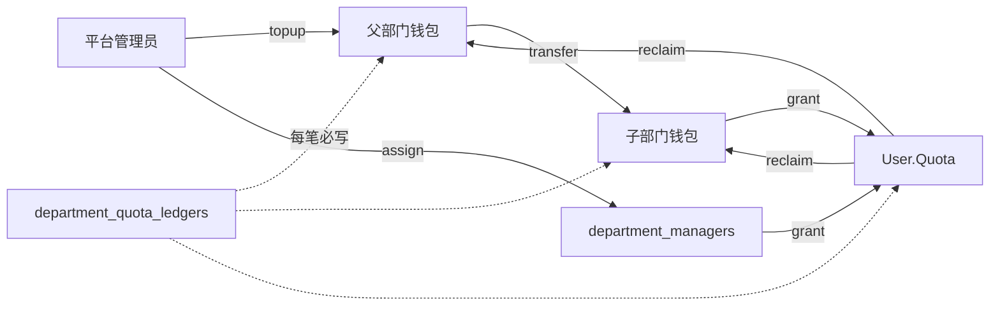

# 部门钱包 P1 实现计划

> **给代理工作者：** 必须使用 superpowers:subagent-driven-development（若环境支持子代理）或 superpowers:executing-plans 执行本计划。步骤用复选框（`- [ ]`）跟踪。测试遵循仓库约定：`testify/require` + `assert`；同一功能集中到尽量少的测试文件。仅在用户明确要求时 commit。

**目标：** 在 P0 部门钱包之上，支持部门管理人、父部门→子部门划拨、从个人回收额度到部门钱包，并增强管理台（指派管理人、划拨、回收、权限可见范围）。

**架构：** 新增 `department_managers` 关联表；余额变动继续走事务 + `lockForUpdate` + 强制 ledger。平台管理员保留全局能力（含 sync/topup/指派管理人）；部门管理人仅能对本部门（及划拨目标为合法子树）做 grant / transfer / reclaim / 查看流水。API 扣费仍只动 `User.Quota`，不改 relay/`FundingSource`。

**技术栈：** Go（根模块）、GORM、Gin、现有 Auth 中间件、React/TanStack（`web/features/department-wallets`）、SQLite/MySQL/PostgreSQL 三库兼容。

**前置：** P0 已完成（`departments` / `department_wallets` / `department_quota_ledgers`、Admin API、管理台列表/充值/发放/流水）。本计划在此上增量。

---

## 设计假定（已锁定，执行勿再发散）

| 主题 | 决定 |
|------|------|
| 管理人范围 | 用户可被指派为多个部门的 manager；一对 `(department_id, user_id)` 唯一 |
| Topup / Sync / 指派管理人 | **仅平台 Admin**（`role >= Admin`） |
| Grant / Transfer / Reclaim / 读本部门钱包与流水 | Admin **或** 该部门的 manager |
| 列表可见性 | Admin：全部；Manager：仅自己管理的部门（含余额） |
| 子部门划拨 | 源部门必须 enabled；目标必须是源的**后代**（任意深度，Go 侧沿 `parent_id` 上溯校验，兼容三库） |
| 双钱包锁顺序 | 按 `department_id` **升序**加锁，避免死锁 |
| 回收语义 | **不做**按「哪笔 grant」溯源；可回收额 = `min(请求额, User.Quota)`，成功则部门 `quota+=`、`used_quota-=`（下限 0） |
| Ledger `Amount` | 继续表示**本部门钱包**变化量：transfer 源负目标正；reclaim 部门侧为正 |
| 用户侧缓存 | grant/reclaim 成功后同步 `cacheIncrUserQuota` / 对称的 cache 递减（与 P0 grant 一致） |
| P2 仍不做 | HR 人员同步、OIDC 自动挂靠、请求时扣部门池 |

---

## 资金流（P1）



---

## 文件结构（预计）

| 文件 | 职责 |
|------|------|
| `model/department_manager.go` | 管理人实体、CRUD、`IsDepartmentManager`、`ListManagedDepartmentIDs` |
| `model/department.go` | 增加 `IsDescendantOf` / `ListDepartmentsWithWalletsForIDs` |
| `model/department_wallet.go` | `TransferDepartmentQuota`、`ReclaimDepartmentFromUser`、`decreaseUserQuotaTx` |
| `model/department_quota_ledger.go` | 新 type 常量：`transfer_out` / `transfer_in` / `reclaim_user`；可选 `CounterpartyDepartmentId` |
| `controller/department.go` | 新 API + 权限分支（admin vs manager） |
| `middleware/` 或 controller 内 helper | `canManageDepartment(c, deptId)` |
| `router/api-router.go` | 拆 Admin-only 与 UserAuth+部门权限路由 |
| `middleware/access_token_routes.go` | 新路由 scope 登记 |
| `controller/audit.go` | 新审计模板 |
| `model/department_wallet_test.go`（或最多再加一个 `department_manager_test.go`） | P1 核心回归 |
| `web/src/features/department-wallets/*` | 管理人 / 划拨 / 回收 UI |
| `web/src/i18n` | 经 `add-missing-keys.mjs` + `bun run i18n:sync` |

**Ledger 字段增量（推荐）：**

```go
// DepartmentQuotaLedger 增补（可空，旧行保持 0）
CounterpartyDepartmentId int `json:"counterparty_department_id" gorm:"index"`
```

Type 常量：

- `transfer_out`：源部门 `Amount = -quota`
- `transfer_in`：目标部门 `Amount = +quota`（同一事务两行，`CounterpartyDepartmentId` 互指）
- `reclaim_user`：部门 `Amount = +quota`，`TargetUserId` = 被回收用户

---

## Chunk 1: 管理人模型与权限原语

### 任务 1：department_managers + 查询

**文件：**
- Create: `model/department_manager.go`
- Modify: `model/main.go`（AutoMigrate）
- Modify: `model/task_cas_test.go` TestMain/truncate（若测试会碰到新表）
- Test: `model/department_wallet_test.go` 或 `model/department_manager_test.go`（**最多一个**新测试文件）

- [ ] **步骤 1：写失败测试**

```go
func TestDepartmentManagerAssignAndQuery(t *testing.T) {
	// Create dept + user
	// AssignManager(deptId, userId) OK
	// AssignManager 重复 → 幂等或唯一冲突按实现约定（推荐 FirstOrCreate 幂等）
	// IsDepartmentManager(deptId, userId) == true
	// IsDepartmentManager(otherDept, userId) == false
	// RemoveManager → false
	// ListManagedDepartmentIDs(userId) 含该部门
}
```

- [ ] **步骤 2：运行确认失败**

```powershell
$env:GOPROXY='https://goproxy.cn,direct'; go test ./model -run TestDepartmentManagerAssignAndQuery -count=1
```

Expected: FAIL（类型不存在）

- [ ] **步骤 3：最小实现**

```go
type DepartmentManager struct {
	Id           int
	DepartmentId int `gorm:"uniqueIndex:uk_dept_manager;not null"`
	UserId       int `gorm:"uniqueIndex:uk_dept_manager;index;not null"`
	CreatedAt    time.Time
	UpdatedAt    time.Time
}
```

提供：`AssignDepartmentManager`、`RemoveDepartmentManager`、`ListDepartmentManagers`、`IsDepartmentManager`、`ListManagedDepartmentIDs`。

- [ ] **步骤 4：测试 PASS；禁用部门仍可保留管理人行（只是操作钱包时会因 P0 `ensureDepartmentEnabled` 失败）**

---

## Chunk 2: 子部门划拨与回收

### 任务 2：Transfer + Reclaim 不变量

**文件：**
- Modify: `model/department.go`（后代校验）
- Modify: `model/department_wallet.go`
- Modify: `model/department_quota_ledger.go`
- Test: 同一集中测试文件

**不变量：**
1. `amount > 0`；源/目标均 enabled；目标是源的后代；源≠目标。
2. 事务内按 `min(srcId,dstId)` → `max(...)` 顺序 `getDepartmentWalletForUpdate`。
3. 源余额不足 → 整笔回滚。
4. 成功必须写 **两行** ledger（out + in）。
5. Reclaim：用户额度不足 → 回滚；部门 `used_quota` 减少但不得为负（`GREATEST`/`max` 语义：`used_quota = max(0, used_quota-amount)`，三库用 Go 算后写回或 dialect 安全表达式）。
6. 需要 `decreaseUserQuotaTx(tx, userId, amount)`：`WHERE id=? AND quota>=?` 更新，失败返回明确错误（新建 `ErrUserQuotaInsufficient`）。

- [ ] **步骤 1：写失败测试**

```go
func TestDepartmentTransferToDescendant(t *testing.T) {
	// parent topup 1000
	// transfer 400 to child → parent 600, child 400；两行 ledger
	// transfer to non-descendant → error
	// transfer 700 → insufficient
}

func TestDepartmentReclaimFromUser(t *testing.T) {
	// grant 300 to user
	// reclaim 100 → dept +100, user -100, used_quota 200
	// reclaim 999 → insufficient user quota, balances unchanged
}
```

- [ ] **步骤 2：跑测确认 FAIL → 实现 → PASS**

```powershell
$env:GOPROXY='https://goproxy.cn,direct'; go test ./model -run "TestDepartmentTransfer|TestDepartmentReclaim" -count=1
```

- [ ] **步骤 3：实现要点**

```go
func IsDepartmentDescendant(candidateId, ancestorId int) (bool, error) {
	// walk candidate.ParentId until nil; match ancestorId
}

func TransferDepartmentQuota(fromId, toId, amount, operatorId int, remark string) error
func ReclaimDepartmentFromUser(departmentId, userId, amount, operatorId int, remark string) error
```

Reclaim 后：`cacheIncrUserQuota(userId, -int64(amount))`（或已有 decr helper）。

---

## Chunk 3: API 与鉴权拆分

### 任务 3：路由与 controller

**文件：**
- Modify: `controller/department.go`
- Modify: `router/api-router.go`
- Modify: `middleware/access_token_routes.go`
- Modify: `controller/audit.go`
- Test: 优先扩展现有 model 测试覆盖业务；若加 HTTP 测试，**最多一个** `controller/department_test.go`，只测权限分支，不重复余额不变量

**路由建议：**

| Method | Path | Auth | 谁可调用 |
|--------|------|------|----------|
| GET | `/api/department/` | UserAuth + 部门读 | Admin 全量；Manager 仅管理的部门 |
| POST | `/api/department/sync` | AdminAuth | Admin |
| POST | `/api/department/:id/topup` | AdminAuth | Admin |
| GET/POST/DELETE | `/api/department/:id/managers` | AdminAuth | Admin |
| POST | `/api/department/:id/grant` | UserAuth + canManage | Admin 或该部门 manager |
| POST | `/api/department/:id/transfer` | UserAuth + canManage(源) | 同上；目标须为后代 |
| POST | `/api/department/:id/reclaim` | UserAuth + canManage | 同上 |
| GET | `/api/department/:id/wallet` | UserAuth + canManage | 同上 |
| GET | `/api/department/:id/ledger` | UserAuth + canManage | 同上 |

实现 `canAccessDepartment(c, deptId) bool`：`role>=Admin` 或 `IsDepartmentManager(deptId, userId)`。

请求体：

```json
// transfer
{ "to_department_id": 2, "quota": 100, "remark": "..." }

// reclaim
{ "user_id": 9, "quota": 50, "remark": "..." }

// assign manager
{ "user_id": 9 }
```

审计动作（英文模板 key）：

- `department.manager_assign` / `department.manager_remove`
- `department.quota_transfer`
- `department.quota_reclaim`

- [ ] **步骤 1：实现 helper + 调整现有 grant/ledger/list 鉴权**
- [ ] **步骤 2：实现 transfer/reclaim/managers handlers**
- [ ] **步骤 3：access_token 路由表覆盖新路径；跑**

```powershell
$env:GOPROXY='https://goproxy.cn,direct'; go test ./model ./router -run "TestDepartment|TestAccessTokenRouteRulesCoverEveryDashboardRoute" -count=1
```

Expected: PASS

- [ ] **步骤 4：错误映射** — 沿用 P0 `writeDepartmentQuotaError`，增补 `ErrUserQuotaInsufficient`、非法子树、无权（`403` / `ApiErrorT("Access denied")`）

---

## Chunk 4: 管理台 UI

### 任务 4：扩展 `department-wallets` feature

**文件：**
- Modify: `web/src/features/department-wallets/api.ts` / `types.ts`
- Modify: `web/src/features/department-wallets/components/*`
- Create: `managers-dialog.tsx`、`transfer-dialog.tsx`、`reclaim-dialog.tsx`（或合并进 `departments-dialogs.tsx`，保持可读即可）
- i18n：临时 `web/scripts/add-missing-keys.mjs` → `bun run i18n:sync` → 删除临时脚本（遵循 `.agents/skills/i18n-translate`）

**UI 行为：**
1. 行菜单增加：`Transfer`、`Reclaim`、`Managers`（Managers 仅 Admin 可见；可用 `auth.user.role`）。
2. Transfer：选目标子部门（从列表中筛 `parent` 链下的部门）+ 金额 + 备注。
3. Reclaim：搜用户 + 金额 + 备注（复用 grant 用户搜索）。
4. Managers：当前管理人列表、搜索用户添加、移除确认（`ConfirmDialog`）。
5. 非 Admin 的 manager 登录后：侧栏仍进同一页；列表 API 已过滤；隐藏 Sync / Top up / Managers。

- [ ] **步骤 1：API client + types**
- [ ] **步骤 2：对话框与列菜单**
- [ ] **步骤 3：i18n 七语言**
- [ ] **步骤 4：校验**

```powershell
cd web
bun run typecheck
bunx oxlint -c .oxlintrc.json src/features/department-wallets
```

Expected: 无 type/lint error

---

## Chunk 5: 验收与交接

### 任务 5：手测清单

- [ ] Admin：sync → topup 父部门 → 指派 manager
- [ ] Manager 账号：能看到本部门；能 grant；不能 topup/sync；不能操作未授权部门（403）
- [ ] Admin/Manager：父→子 transfer，双方余额与两行 ledger 正确
- [ ] Reclaim：用户额度下降、部门余额回升、`used_quota` 下降
- [ ] 禁用部门：transfer/grant/reclaim 均拒绝
- [ ] 回归：`go test ./model ./router -run "TestDepartment|TestAccessTokenRouteRulesCoverEveryDashboardRoute"`
- [ ] 三库：能起则 SQLite+MySQL+PostgreSQL 各跑相关测试；不能则交接写明 blocker，**不声称**已完成三库验证

---

## 验收标准（P1 Done）

1. 可为部门指派/移除管理人；管理人仅能操作授权部门的 grant/transfer/reclaim/ledger。
2. 父→任意深度子部门划拨成功；非后代拒绝；双钱包锁序无死锁、账本成对。
3. 可从个人回收额度回部门；用户不足拒绝；不改 API 计费主链路。
4. 管理台支持指派、划拨、回收；Admin 与 Manager 可见操作正确区分。
5. 审计与 access token 路由表覆盖新动作；测试集中、可重复。

## 后续（P2，不在本计划）

- HR 人员-部门同步、OIDC/SSO 登录自动挂靠部门
- 按 grant 溯源的精细回收 / 预算周期
- 部门池直接作为请求扣费 `FundingSource`

---

## 执行交接

计划已保存到 `.agents/plans/2026-11-02-department-wallet-p1.md`。

准备开始按 Chunk 1 执行实现吗？
